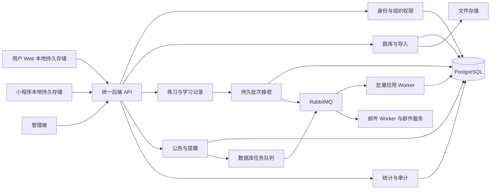

# 旧版 QandA 练习同步后端设计方案

本文记录旧版练习同步原型的设计与实现背景；当前 Kotlin API 合同见[聚合合同](contracts/openapi.yaml)。

日期：2026-10-11；当时的首版同步接口见[旧版接口合同](sync-api.md)。

本方案覆盖用户 Web、小程序、管理端。依据为桌面 `QandA原型稿` 目录内三个 ZIP 中的 **57 张 PNG（Web 18、小程序 23、管理端 16）及一份清单**。逐图索引见 [原型覆盖清单](prototype-coverage.md)，字段见 [数据字典](backend-fields.md)。图片中的演示人名、数字、日期和文案用于识别业务含义，不作为生产配置；清单作为来源材料核对页面版本。

## 1. 已确认方向与设计边界

| 项目 | 结论 | 依据 |
|---|---|---|
| 考试／测试 | 客户端限时自测和判题，交卷后展示结果，允许离线完成后补传 | 用户本轮明确确认 |
| 跨端进度 | 同一账号在 Web、小程序之间继续同一场练习 | 用户本轮明确确认 |
| 普通用户 | 邮箱验证注册或微信身份接入；管理端编辑已有用户 | 登录、账号、用户列表及原型清单 |
| 内容结构 | 推荐统一为科目 → 单元 → 题目；“课程”对应科目，“章节”对应单元 | 用户端目录、管理端权限；工作台完整定稿缺失 |
| 可见范围 | 公共科目、组织继承、用户单独添加；用户可屏蔽继承科目 | 管理端可见性与用户科目弹窗 |
| 学习闭环 | 选范围 → 配置 → 作答／保存 → 跨端继续 → 交卷 → 回顾／重练 → 统计 | 两个用户端 |
| 本阶段产物 | 同步后端、迁移、命令行模拟器、接口合同及验收记录 | 当前执行方案 |

下面标为“建议”的内容，是为了让原型能落地而补充的规则；原型没有表达的规则仍需评审。文件修改范围为 `apps/api/`。

## 2. 从最核心的四件事开始

1. **人是谁、能看什么**：统一用户 ID，邮箱与微信绑定到该 ID；组织和科目权限由服务端计算。
2. **题目是什么**：科目、单元、题型、选项、标准答案、解析、版本必须稳定，导入必须能定位错误。
3. **这一场练习做到哪里**：服务端保存题序、配置、答案、标记和当前位置；客户端执行计时，两个端通过写入权接管读取同一场次。
4. **学习结果怎么算**：区分已答正确率、题目覆盖率、得分、累计作答次数；保存、重试和跨端不能重复累计。

采用 **本地优先答题 + 模块化单体 + PostgreSQL + RabbitMQ**。所有练习在客户端持久保存并本地判题，按时间、数量、阶段批量同步；后端先短事务保存接收批次，再通过 RabbitMQ 驱动批量应用。首版采用 Kotlin 2.2.21 / Spring Boot 3.5.16，运行版本见 [README](README.md)。头像、封面、富文本图片放对象存储；数据库保存文件元数据。计划任务由数据库保存计划，通过独立队列执行。完整同步协议见 [本地优先答题与云端同步方案](local-first-sync-design.md)。



## 3. 模块总表

| 模块 | 必须提供的业务 | 主要数据 | 阶段 |
|---|---|---|---|
| 用户身份 | 邮箱验证码注册、密码登录、找回／修改密码、更换邮箱、微信登录绑定、退出 | 用户、微信身份、验证挑战、登录会话 | P0；微信 P1 |
| 组织与授权 | 学院、专业、用户归属、公共科目、学院／专业范围、个人添加／屏蔽 | 学院、专业、科目授权关系 | P0 |
| 题库 | 科目／单元管理、题目增改停用、排序、检索、JSON 批量导入 | 科目、单元、题目、题目版本、导入批次 | P0；完整检索 P1 |
| 练习 | 范围预览、配置、开练、答题、答题卡、计时、保存退出、跨端继续、交卷 | 场次、场次题目、幂等操作 | P0 |
| 学习记录 | 结果、解析回顾、错题、收藏、重练、最近学习 | 场次结果、错题关系、收藏关系 | P0 |
| 个性化 | 练习默认值、布局、字号、震动、重置默认 | 用户偏好 | P1 |
| 公告 | 草稿、预览、指定受众、指定端、定时发布、详情与跳转 | 公告、受众、任务 | P1 |
| 邮件提醒 | 总开关、复习日程、个人考试、提前天数、取消及失败重试 | 提醒设置、考试、发送任务 | P2 |
| 数据分析 | 个人统计、热力图、运营活跃、留存、排行、仪表盘 | 作答事实、活跃记录、可重建聚合 | 基础 P0；运营 P2 |
| 管理安全 | 管理员账号、安全策略、登录保护、操作日志 | 管理员、会话、策略、审计 | 基础 P0；高级 P2 |

P0 是建议的首个闭环，不表示其他图被忽略。每阶段对应的字段已列入数据字典，实施时按阶段建表。

## 4. 业务模型与规则

### 4.1 身份、账号和组织

- 用户主键 `userId` 永久稳定；邮箱、昵称、微信身份均可变化。原型中的 A103 等作为展示编号 `userCode`，与邮箱登录标识区分。管理端“姓名”与用户昵称分别存 `displayName`、`nickname`，避免管理员改姓名覆盖用户昵称。
- 邮箱验证成功后原子创建账号，重复请求返回同一结果。邮箱做统一规范化与唯一校验；原地址用于展示。邮箱本地部分大小写折叠作为产品登录规则固定下来，不能一处折叠、一处区分。
- 验证码区分注册、找回密码、绑定、更换旧邮箱验证、更换新邮箱验证等用途；有到期、次数、频控、一次性消费。找回入口避免泄露邮箱是否注册。
- 密码只存自适应单向哈希；会话凭据和验证码不写日志。Web 推荐 Secure / HttpOnly Cookie 会话并做 CSRF 防护，小程序使用可撤销的服务端会话令牌。保持登录改变会话有效期，不保存明文密码。
- 管理端“记住账号”是客户端偏好，与持久登录分开。管理员身份与普通用户身份使用独立认证域和会话权限。
- 首次微信接入由服务端兑换临时登录凭证，再决定绑定已有用户还是完成注册。客户端上传的 openid 不能直接证明身份。不能依赖每次都获得 unionid。
- **建议首次微信用户先完成邮箱绑定，再进入学习闭环**，这样同一账号能自然跨 Web 使用。原型也允许理解为微信先独立使用，因此列为待确认事项；若允许独立使用，`email` 可空，邮箱提醒须禁用，并需要双账号合并流程。
- 已有邮箱与微信账号碰撞时返回 `ACCOUNT_LINK_REQUIRED`，要求验证双方归属后确认绑定。已有两个独立且含学习数据的用户，不自动合并；需另定历史、收藏、组织权限和活跃场次冲突策略。
- 更换邮箱验证旧邮箱和新邮箱，一次事务完成唯一校验、更换、挑战消费和会话撤销；重新登录。已排队提醒发送前重新读取当前已验证邮箱。
- **新注册用户默认仅有公共科目**。学院／专业由管理端分配；用户自行注册不等于可以自行选择组织获得权限。用户仅选 `majorId`，学院由专业归属推导。
- 普通用户建议状态 `ACTIVE / DISABLED`。原型中的“待激活”先作为 `PENDING_VERIFICATION` 展示语义；是否需要真正持久的待激活用户由注册流程决定，不能让未验证用户进入正式权限域。
- 管理员修改用户邮箱应发起验证变更流程；直接强改属于额外高权限恢复能力，不能等同普通资料编辑。禁用用户立即撤销会话，保留历史记录。

### 4.2 内容结构、题型与版本

| 名称 | 统一含义 | 注意 |
|---|---|---|
| 科目 Subject | 用户书架上的课程，如计算机网络 | 权限授予到科目；支持封面、简介、分类、排序 |
| 单元 Unit | 科目下的章节，如数据链路层 | 章节练习的范围；支持排序、停用 |
| 题目 Question | 单元下的稳定题目身份 | 建议一题归属一个单元 |
| 题目版本 Revision | 某次题干、答案、解析的完整内容 | 已开始场次引用版本，之后改题不改变旧结果 |
| 题库 | 页面上的集合称呼 | 当前建议整科题库=科目全部单元；单元题库=单元题目 |

管理端仪表盘另有“题库数”，但完整工作台图缺失。**若一科确有多个独立题库／版本，需改为科目 → 题库 → 单元 → 题目，并明确授权粒度。此项应在建库前确认。** 当前不要把同一个集合同时建成“课程表”“科目表”“题库表”。

题型建议：`SINGLE_CHOICE / MULTIPLE_CHOICE / TRUE_FALSE / SHORT_ANSWER`。简答题在小程序搜题图中明确出现，但作答与判分页面缺失：首版可支持导入、搜索、背题，客观题练习先排除简答题并返回排除数量。简答题是否自评、人工评分，需要单独决定；不假定存在自动语义判分。

选择题选项使用稳定键，如 `opt_1`，A/B/C/D 是展示标签。判断题答案为布尔值；多选答案为无序唯一集合，建议全对得分，漏选／错选零分，部分分需另定。单题分值采用定点数。题干、选项、解析支持受限富文本及附件；服务端清理危险 HTML、校验文件来源。

管理员编辑生成新版本；已开练场次保留旧版本。题目停用后退出新练习和搜索；普通停用保留历史回顾，涉及泄露或内容撤回时可另外禁止历史正文访问。删除被引用内容采用归档，禁止级联删除学习历史。排序更新使用版本校验和同父级 ID 完整校验。

### 4.3 科目可见性

设 `P` 为公共科目，`C` 为学院开放科目，`M` 为专业选择科目，`B` 为个人屏蔽继承科目，`G` 为个人添加科目：

**用户可见科目 = 已启用科目 ∩ [ P ∪ ((C ∩ M) − B) ∪ G ]**。

- 未分配专业，或专业／学院已停用时，继承集合为空；公共科目始终可见。个人屏蔽只作用于继承来源，不屏蔽公共课。
- 同一科目多个来源只算一个；接口返回 `sources[]`、`effectiveVisible`、`canBlock`、`canRemove`，直接驱动弹窗状态。
- 专业只能选择所属学院开放的科目。学院收回授权时，同事务清除专业对应选择；界面先预览受影响专业／用户数量，确认后执行。
- 用户科目弹窗采用一次保存事务，带关系版本号；避免逐项网络请求只保存一半。
- 个人“添加”与“屏蔽”在同一用户科目关系上采用互斥效果。建议组织变更时清除旧继承屏蔽，保留明确个人授予，并在编辑确认中列出影响；此规则需评审。
- 列表、搜索、答案详情、收藏、错题、开练、继续和导出使用同一权限判断。不能只隐藏书架入口。
- 建议权限收回后阻止继续作答和读取受限正文；保留成绩摘要，返回 `ACCESS_REVOKED`。普通题目停用与用户失去整个科目访问权分别处理。

### 4.4 一场练习的完整生命周期

**创建时固定**：用户、来源、科目／单元范围、题目 ID 与版本、题序、模式、反馈方式、限时、分值。随机顺序只生成一次，跨端恢复读取已存题序。

来源 `SUBJECT / UNIT / WRONG_BOOK / FAVORITES / RESULT_WRONG`；创建前先预览可用题数、已排除题数、范围名称。错题／收藏可跨科目，必须逐题过滤权限。空集合返回明确业务错误。

| 模式 | 作答与答案展示 | 云端职责 |
|---|---|---|
| PRACTICE 练习 | 固定题包含答案，本地即时判题，首次确认锁定 | 保存客户端判定、快照与最终结果 |
| TEST 个人自测 | 题包含答案但客户端交卷前隐藏反馈，本地计时与判题 | 校验数据内部一致性，允许离线补传 |
| MEMORIZE 背题 | 后续功能；显示参考答案并保存位置 | 以后扩展浏览同步，首版未实现 |

- 首版创建场次需要联网，然后可离线答题；客户端状态加密持久保存。
- 普通练习初始30秒或10道题合批；暂停、换端、完成立即同步。操作顺序、批次去重与接收／应用水位见同步合同。
- 云端状态 IN_PROGRESS、FINISHING、COMPLETED、FINISH_REJECTED；接收状态 OPEN、HANDOVER、SEALED、CLOSED 单独控制。
- 一个场次一个写入实例，跨端先固定接收屏障、应用已收批次，再递增writerEpoch。旧端未上传内容不能覆盖新端。
- 本地首次确认的答案和判定不允许修改，云端核对最终结果与已应用快照，避免同步不完整。
- 限时由客户端执行，云端不以截止时间拒绝补传、不重新判题。客户端完成时间不代表可信考试时间，结果来源标记 CLIENT_REPORTED。
- 首版接口和状态以 [接口合同](sync-api.md) 为准；完整同步实现说明见 [同步方案](local-first-sync-design.md)。

### 4.5 错题、收藏、搜索、练习偏好

- 错题本以 `(userId, questionId)` 唯一，记录首次错、最近错、错次数、最近复习、状态。自动收错开关只影响新错题入库，不删除已有错题。
- 建议错题复习一次答对标为 `REVIEWED`，再答错回到 `NEEDS_REVIEW`；保留历史。待复习数量与历史错题总数分别返回。是否答对即移出默认列表列为待确认。
- 收藏开关幂等；列表返回所属科目／单元，隐藏已失去权限的正文，并可返回失效数量。搜题查看答案不产生答题记录。
- 搜索范围覆盖当前科目或所有可见科目；支持题干、选项、标准答案文字、解析，以及题型、章节、最近作答状态、排序。原型提及“知识点”但无维护页，建议题目允许简单标签，不单独构建知识图谱。
- 搜索先在数据库实现中文子串检索与明确的匹配权重：题干优先，其次选项／答案／解析；返回命中片段和高亮区间。上线前用真实中文题量测查询性能，再决定索引方案。
- `answerStatus` 表示最近已判定结果，不能把“收藏”“标记”“历史做过”混成一个枚举。
- 练习默认偏好跨端共享；布局顺序、字号、震动按客户端保存。场次创建后使用配置快照，修改默认偏好不改变进行中的场次。
- 自定义布局只保存五个预定义区域的合法排列，底部操作作为整体。图中“预设”先提供系统默认和当前自定义；是否需要多套命名预设待确认。

### 4.6 公告与邮件提醒

公告字段包含标题、摘要、正文、作者展示名、受众类型、指定用户、展示端、发布方式、计划时间、实际发布时间、状态、跳转目标。**受众与展示端是两个独立维度**；“所有用户”不等于“所有客户端”。

状态建议 `DRAFT → SCHEDULED → PUBLISHED → WITHDRAWN`，草稿也可直接发布。定时任务校验当前状态与版本，取消或修改计划使旧任务失效。普通端只返回当前已发布且匹配用户和客户端的公告；预览只给管理员。跳转使用站内目标类型与 ID 白名单，目标仍需权限检查。原型有“审核通过后”文案但无审核角色／页面，审批流程列为待确认。

邮件设置：总开关、复习提醒开关、星期集合、发送本地时间、时区、考试提醒开关、默认提前天数。个人考试包含名称、日期、提醒提前天数。Web 与小程序的提醒时间／天数示例不同，以保存的设置为准，不分别建两套规则。

每次计划发送生成唯一任务键 `(userId, ruleType, sourceId, sourceVersion, scheduledAt)`；设置改变或考试删除取消旧任务。发送前复查开关、账号状态、已验证邮箱和任务版本。故障重试保留提供商消息 ID；邮件服务不支持幂等时，超时后的重复投递风险需要监控，不能承诺绝对一次送达。跨时区日历按用户时区换算；已过考试不继续生成提醒。图中的“考试周”如是独立学校安排，还需管理入口和日期来源；首版个人考试足够支撑已画出的添加弹窗。

### 4.7 管理员、安全与操作日志

- 管理员可以新增、编辑、禁用、删除；有审计引用的删除建议转为归档。至少保留一个可用超级管理员，禁止通过普通账号编辑路径提升自身权限。
- 原型未提供角色页。建议最初固定 `SUPER_ADMIN / OPERATOR` 两档，普通运营不能管理管理员和安全策略，后续有真实分工再细分权限。
- 安全设置包含失败锁定开关／阈值／时长、空闲退出时长、新设备验证、密码最小长度和字符要求、首次登录强制改密。密码始终按原字符校验；图中“区分大小写”不能设计成可关闭的密码忽略大小写模式。
- 新设备验证需要可靠因素，建议管理员验证邮箱；没有验证因素时不能开启开关。管理员找回密码同样需定义该渠道。此依赖在高级安全阶段落实。
- 操作日志记录操作者快照、模块、动作、目标、结果、脱敏前后差异、来源 IP、客户端、时间、请求 ID；不可被业务账号编辑。验证码、密码、完整令牌、密钥不进入审计差异。

## 5. 统计口径：先确定含义，再画图

| 指标 | 建议口径 | 特别说明 |
|---|---|---|
| 单场已答数 | 已填写并在结算时认可的答案数 | 未答独立计数 |
| 已答正确率 | 正确客观题数 ÷ 已判定且已答客观题数 | Web 原型 95/110=86.4%；小程序 12/15=80%；分母为 0 返回 null |
| 单场题目分布 | 正确／错误／未答分别除以总题数 | 不能使用已答正确率充当正确扇区占比 |
| 得分 | 所有题目实际得分之和；满分=入场分值之和 | 未答为 0；与正确率分开 |
| 科目已做／覆盖率 | 当前可用题目中，至少有效作答一次的不同题目数 ÷ 当前可用总题数 | 重练不重复增加覆盖数；分母变动会改变进度 |
| 累计答题量 | 有效作答事实数 | 同题不同场次可重复计；同场请求重试不重复计 |
| 历史正确率 | 正确事实数 ÷ 可判定的已答事实数 | 不能平均每场百分比 |
| 练习次数 | 已结算的对应范围场次数 | 未完成数另外返回；“本章”跟随选中单元 |
| 今日／连续学习 | 本地日期至少一次有效作答为学习日 | 背题是否参与连续学习待确认，默认不参与答题连续天数 |
| 学习时长 | 各场有效前台学习秒数 | 后台挂机、跨端并发时间段须去重或限为活动端 |
| 热力图 | 每个本地日期有效答题数 | 按图分档 0、1–10、11–20、21–30、31+ |
| DAU / WAU / MAU | 当日／最近 7 日／最近 30 日有有效活跃事件的不同用户数 | WAU/MAU 不是 DAU 相加 |
| 7 日留存 | 注册日 cohort 中，第 7 日活跃人数 ÷ 该日注册人数 | 只统计已满 7 日 cohort；“7日内回来过”是另一指标 |
| 新／老用户活跃 | 当日活跃且当日注册／早于当日注册 | 跨端同 userId 去重 |
| 活跃排行 | 区间不同活跃日期数降序，其次作答量、userId | 页面可稳定分页 |
| 常用在线时段 | 有效前台活跃分钟最多的时段 | 仅登录时间不足以推断；完整覆盖 00–24 点 |
| 常用端／端占比 | 每用户各端活跃分钟排序；图表占比采用各端活跃分钟占比 | 跨端用户人数相加可能超过去重总人数，需在接口标注 metric |
| 环比 | 当前区间与前一个等长区间比较 | 前值 0 返回变化方向及 null 比率，不显示 Infinity |

首版保存客户端上报判定，不核对标准答案；汇总必须与逐题结果及已同步答案一致。后续统计基于 CLIENT_REPORTED 数据，不作为可信考试成绩。当前首版仅实现场次结果与恢复查询，错题、收藏和个人／运营统计仍待后续实施。

所有时间戳存 UTC；统计接口显式传 `timezone`，默认 `Asia/Shanghai`。日期区间统一左闭右开；同一页面的总数与图表必须使用相同的过滤条件。

## 6. API 清单与契约

以下是整体后续接口设计；首版以 [实际接口合同](sync-api.md) 为准，其中完成接口为 finish，且不提供云端自动判题。

前缀 `/api/v1`；普通用户接口从会话取 userId，禁止相信请求中的任意 userId。管理接口 `/admin` 另做权限检查。以下是职责清单，具体 OpenAPI 在实现阶段生成。

| 接口组 | 建议接口 | 主要输入 → 输出 |
|---|---|---|
| 验证与邮箱注册 | `POST /auth/email-challenges`、`POST /auth/register` | purpose/email；challengeId/code/password/consent → cooldown/expiresAt；登录态、user |
| 登录与退出 | `POST /auth/login`、`POST /auth/logout`、`GET /me` | email/password/keepLoggedIn → 当前资料、能力、会话到期 |
| 密码恢复 | `POST /auth/password-reset` | challengeId/code/newPassword → 完成、撤销旧会话 |
| 微信 | `POST /auth/wechat`、`POST /me/wechat-binding` | 临时 code、绑定验证上下文 → 登录／待绑定状态 |
| 账号修改 | `PATCH /me/profile`、`POST /me/password-change`、`POST /me/email-change` | 资料或双方邮箱验证凭据 → 更新后资料 |
| 文件 | `POST /files` | 用途、文件 → fileId、受控 URL；头像上传有所属校验 |
| 首页 | `GET /me/home` | client/timezone → 今日指标、最近科目、公告、最近可继续场次 |
| 内容目录 | `GET /subjects`、`GET /subjects/{id}/units` | 分页 → 目录、各范围题数、已做、覆盖率、正确率 |
| 搜题 | `GET /questions`、`GET /questions/{id}` | keyword/scope/type/answerStatus/sort → 命中片段、总数、收藏、来源；详情含授权后的解析 |
| 范围与开练 | `POST /practice/preview`、`POST /practice/sessions` | scope/config/replaceSessionId → 可用数；固定题序、配置、deadline、version |
| 恢复 | `GET /practice/sessions/resumable`、`GET /practice/sessions/{id}` | 范围可选 → 摘要／完整保存状态、serverNow、version |
| 进度与作答 | `POST /practice/sessions/{id}/sync-batches`、`GET /practice/sessions/{id}/sync-status` | batchId/epoch/连续序号/操作 → 接收凭据、接收与应用水位 |
| 标记、位置与活动 | 合并到 `sync-batches`；`POST /practice/sessions/{id}/takeover` 接管 | 标记／位置／活动区间合批；接管返回新 epoch 与已应用快照 |
| 暂停／继续 | `POST /practice/sessions/{id}/pause`、`POST /practice/sessions/{id}/resume` | epoch/requestId/目标序号 → 接收状态；限时不顺延 |
| 交卷与结果 | `POST /practice/sessions/{id}/submit`、`GET /practice/sessions/{id}/result` | epoch/requestId/finalSeq/snapshotHash → 处理中；结算完成后返回正式结果 |
| 收藏／错题 | `PUT/DELETE /me/favorites/{questionId}`、`GET /me/favorites`、`GET /me/wrong-questions` | 筛选 → 分页记录、单元数、待复习数 |
| 统计与历史 | `GET /me/statistics`、`GET /me/practice-history` | 日期/时区/科目 → 指标、趋势、热力、历史明细 |
| 偏好 | `GET/PATCH /me/preferences`、`POST /me/preferences/reset` | 业务偏好、client 展示偏好、version → 完整生效值 |
| 公告 | `GET /announcements`、`GET /announcements/{id}` | client/分页 → 匹配受众的公告 |
| 提醒与考试 | `GET/PATCH /me/reminder-settings`、`GET/POST /me/exams`、`PATCH/DELETE /me/exams/{id}` | 开关/周期/时间；考试名称日期偏移 → 生效设置 |
| 内容管理 | `/admin/subjects`、`/admin/units`、`/admin/questions` CRUD、各目录 `/order` | 内容/版本/同父级排序 → 保存后的版本 |
| 导入 | `POST /admin/imports`、`GET /admin/imports/{id}`、`POST /admin/imports/{id}/confirm`、`DELETE /admin/imports/{id}` | 多文件/目标 → 进度/问题/预览；确认结果 |
| 组织 | `/admin/colleges`、`/admin/majors` CRUD | 名称/状态/父学院 → 组织树；删除前引用校验 |
| 科目授权 | `PUT /admin/public-subjects`、`PUT /admin/colleges/{id}/subjects`、`PUT /admin/majors/{id}/subjects`、`GET/PUT /admin/users/{id}/subjects` | 集合、version、影响确认 → 有效范围、来源、受影响数量 |
| 普通用户管理 | `GET /admin/users`、`PATCH /admin/users/{id}` | 查询/资料/专业/状态 → 资料、统计摘要、变更影响 |
| 公告管理 | `/admin/announcements` CRUD、`/{id}/preview`、`/{id}/publish`、`/{id}/withdraw` | 内容/受众/渠道/计划 → 状态与时间 |
| 管理认证与账号 | `/admin/auth/login`、`/admin/auth/logout`、`/admin/auth/password-reset`、`/admin/accounts` CRUD | 独立凭据／管理员资料 → 管理会话／账号 |
| 运营和系统 | `GET /admin/dashboard`、`GET /admin/activity`、`GET /admin/activity/ranking`、`GET/PATCH /admin/security-policy`、`GET /admin/audit-logs`、`GET /admin/audit-logs/{id}` | 日期/端/筛选 → 指标、策略、日志 |

统一契约：ID 为字符串；金额以外的分值也使用精确小数序列化；计数整数；无分母的百分比返回 null。分页响应 `items,total,page,pageSize`，稳定排序添加 ID 作为并列次序；范围筛选必须作用于 total。写请求版本过期返回 409，参数错误 400，未登录 401，明确禁止操作 403，隐藏资源 404，业务不满足 422，频控 429。错误体 `code,message,fieldErrors,requestId,currentVersion?`。幂等键重用但负载不同返回冲突。

用户端题目响应按模式组装白名单 DTO。首版题包包含本地判题所需答案与解析，TEST 的展示限制由客户端执行；云端结果来源为 CLIENT_REPORTED，个人自测不承诺防作弊。

## 7. JSON 批量导入

流程：上传到暂存区 → 逐文件解析 → 结构／业务校验 → 展示计数及逐题错误 → 全部有效后确认 → 单事务入库 → 清理临时文件。取消不产生正式题目。确认必须检查目标仍可用、源文件哈希未变、批次版本相同。

推荐初始文件格式：

```json
{
  "schemaVersion": 1,
  "questions": [{
    "sourceKey": "network-001",
    "type": "SINGLE_CHOICE",
    "stem": "以下哪一项属于传输层协议？",
    "options": [{"key":"opt_1","content":"TCP"},{"key":"opt_2","content":"IP"}],
    "answer": {"optionKeys":["opt_1"]},
    "explanation": "TCP 属于传输层协议。",
    "score": "2.00",
    "tags": ["网络分层"]
  }]
}
```

目标单元由后台选择，文件不能任意给自己指定权限或覆盖其他科目。`sourceKey` 在单元内唯一；首次导入建议只新增，重复键作为错误，重复内容指纹作为警告。将来若需要覆盖，单独做明确的更新预览。多文件同批全部成功或全部不入库；失败要返回 `fileName + itemIndex + field + code + message`。

校验：必填、长度、合法题型、选项键不重复、答案引用存在、单选恰好一个正确项、多选至少两个正确项、判断题布尔、分值非负且精度合法、富文本和文件引用安全、sourceKey 冲突。简答题采用 `answer.referenceText`，不混用选项键。容量限制以真实题库压测确定并在上传前返回；文件级数量与字节上限必须存在。进度来自实际解析任务，不按前端计时模拟。

## 8. 建议开发顺序与验收

| 阶段 | 交付 | 必过验收 |
|---|---|---|
| P0-A 身份与内容 | 邮箱登录注册、管理认证、组织授权、科目单元题目、导入 | 用户只能看到授权科目；注册重试不重复；导入失败无半批数据；既有历史题版本不被编辑覆盖 |
| P0-B 学习闭环 | 三种模式、本地保存、RabbitMQ 批量同步、跨端继续、答题卡、交卷、收藏错题、基础统计 | Web 做第 5 题后小程序继续；重复批次／故障重放不丢不重；接管屏障正确；客户端自测隐藏反馈并本地到时结算，断网后补传；未答正确展示；重复提交不增加答题量 |
| P1 原型主要功能 | 微信账号连接、搜索、偏好和布局、公告、完整个人统计 | 一个账号两端同进度；搜题不泄露无权限内容；改偏好不改当前场次；定时公告取消后不发布 |
| P2 运营与提醒 | 邮件任务、个人考试、留存排行、高级安全和日志查询 | 关闭提醒后待发送任务不发送；换邮箱不发往旧邮箱；跨端活跃去重；最后管理员保护；敏感字段不进日志 |

实施时先写 P0 的数据库迁移与接口契约，再实现主流程。原型覆盖不意味着需要一次性把所有模块写完。

## 9. 开工前需要拍板的规则

已确认：个人自测、单端写入与换端接管、本地优先、客户端判题、云端保存 CLIENT_REPORTED 结果、到时后允许补传与 RabbitMQ 批量同步。离线保留期和生产容量仍待评审。剩余问题按影响排序：

| 问题 | 本稿建议 | 影响 |
|---|---|---|
| 科目下是否真有多个独立题库？ | 先采用科目 → 单元 → 题目 | 核心外键、导入范围、仪表盘“题库数”；建库前确认 |
| 微信能否不绑邮箱直接学习？ | 首次微信进入学习前绑定邮箱 | 空邮箱用户、跨端账号识别、双账号合并 |
| 新用户组织从哪里来？ | 管理员分配专业，新用户只有公共课 | 注册后访问范围；不从自填资料直接授予权限 |
| 简答题如何判分？ | 先支持搜题和背题，排除自动判分场次 | 答题表单、正确率分母、评分规则 |
| 错题答对后如何处理？ | 标为已复习并退出待复习列表，保留历史 | 错题数量和复习节奏 |
| 组织变更时个人授权怎么处理？ | 保留明确个人添加，清除旧继承屏蔽并展示影响 | 权限延续和管理员认知 |
| 公告是否需要审核？ | 首版有发布权限者直接发布 | 审核角色、状态流、页面补充 |
| “考试周”是否为独立公共日历？ | 先实现个人考试日期与提醒 | 学校日历的数据来源和维护入口 |
| 多套练习预设与背题连续天数？ | 默认一套自定义；背题不计答题连续天数 | 偏好存储与统计定义 |
| 管理员新设备验证／找回渠道？ | 绑定并验证管理员邮箱 | 安全开关能否实际生效 |

## 10. 实施参考

密码存储采用框架现有 `PasswordEncoder` 能力，使用可升级的单向密码哈希，参考 [Spring Security 密码存储文档](https://docs.spring.io/spring-security/reference/7.0/features/authentication/password-storage.html)。

唯一性、外键与必要 CHECK 约束在数据库落实；跨表授权子集规则由事务实现，参考 [PostgreSQL 约束文档](https://www.postgresql.org/docs/16/ddl-constraints.html)。引用用于校核能力，不作为本项目版本锁定。

微信服务端认证接入需在实施时对照官方文档和实际 AppID 验证；本轮官方页面抓取失败，未验证接口可调用性。邮件服务、对象存储、部署环境和性能容量也应在相应实施阶段验证。
