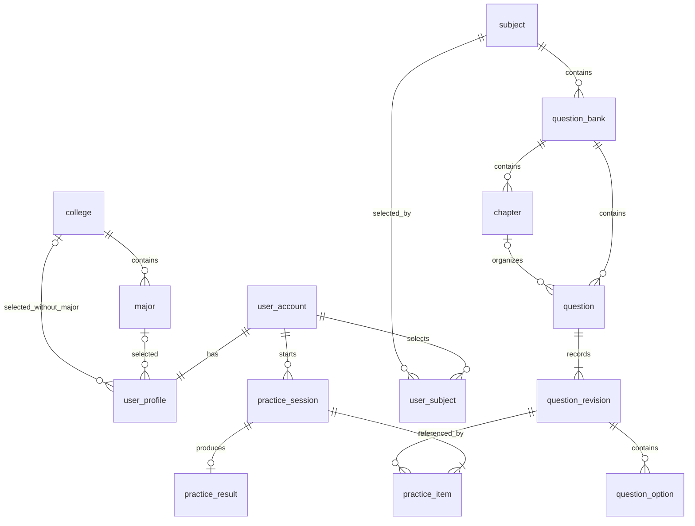

# QandA 后端架构与数据库

## 工程与职责

后端是一个 Spring Boot 应用和一个 Maven 工程，应用及接口合同保持 `1.0.0`。Kotlin 2.2.21、JDK 21、Spring Boot 3.5.16 与 MyBatis-Plus 3.5.18 共同构成当前构建基线。

按业务划分 `identity`、`admin`、`catalog`、`content`、`discovery`、`practice`、`learning`、`operations`，`platform` 提供事务、安全、文件、邮件、HTTP 和初始化能力。

每个业务模块中，Controller 接收请求并返回 DTO，Service 处理权限、规则和事务，Mapper 执行数据库访问，实体只描述持久化记录。单表 CRUD 使用 `BaseMapper`，简单过滤使用 `QueryWrapper`；复杂查询、复合主键、锁定和统计在 Mapper XML 中完成。MyBatis-Plus 3.5.18 的 Kotlin 元数据要求 2.4 编译器，而工程保留 Kotlin 2.2.21，因此仅使用该版本的 Java API，并在编译配置中跳过依赖元数据版本检查。

写命令由统一事务保存业务变更、成功审计和幂等回执。业务 Service 复用同一数据源；验证码错误次数、登录失败次数及失败审计在独立事务保存。Controller 和 Service 不拼接 SQL，初始化程序负责执行 DDL。

## 数据关系

数据库按用途分组，使用同一个 PostgreSQL 数据库和外键关系。表数量服从实体职责和关系，减少的是重复事实和不一致的数据来源。

| 用途 | 表 |
| --- | --- |
| 用户和组织档案 | `user_account`、`user_profile`、`user_wechat`、`college`、`major` |
| 管理档案与内容职责 | `admin_account`、`bank_maintainer` |
| 内容档案与明细 | `subject`、`question_bank`、`bank_audience`、`chapter`、`question`、`question_revision`、`question_option`、`question_attachment` |
| 用户主动选择 | `user_subject`、`user_favorite` |
| 练习事实 | `practice_session`、`practice_item`、`practice_item_choice`、`practice_result` |
| 反馈和运营 | `question_feedback`、`course_request`、`announcement`、`announcement_platform`、`announcement_recipient`、`user_activity` |
| 系统运行 | `user_session`、`admin_session`、`security_policy`、`admin_control`、`login_attempt`、`email_challenge`、`wechat_ticket`、`mail_delivery`、`file_asset`、`command_receipt`、`audit_log` |

完整 DDL 以[当前建表脚本](../apps/api/src/main/resources/db/schema.sql)为准。

### 档案与引用

- 学院与专业为一对多。用户选专业时只保存专业外键，由专业推导学院；只选学院时保存学院外键。数据库约束两个归属字段互斥。
- 学生资料、院系与入学年份可以为空。管理员账号独立保存，固定平台管理员和内容管理员两种角色。题库维护者通过关联表指定。
- 课程拥有多个题库，题库拥有章节和题目。章节可空，复合外键保证题目的章节与题库一致。章节含题时先移走题目再删除。
- 题库的适用范围为全校或多行条件。同一行条件同时满足，多行取任一匹配；专业条件从专业推导学院。适用范围用于推荐。
- 我的课程按用户、课程唯一；常用题库的复合外键保证其属于同一课程。收藏按用户、题目唯一。

### 题目、练习与历史

题目保留稳定 ID，修订表保存题型、题干、解析、判断答案或简答参考答案，选择项放入子表。图片通过修订与文件关联。修订、选项、附件、练习结果和审计事实由数据库触发器保护。

练习创建时固定修订和题序，恢复读取原记录。每个用户在同一题库最多有一个进行中的练习，可以取消后重新创建。进度保存使用会话并发字段；即时反馈中已确认的作答不可修改，标记与收藏分别保存。

交卷锁定会话，在同一事务内完成判题、唯一结果和会话状态更新。多选题未确认时按未答处理；简答题先保存作答，交卷后由学生自评。客观题结果保持固定，自评结果单独更新。题库下架后保留已发放练习的快照和对应图片访问。

有业务引用的学院、专业、课程、题库和题目采用停用、下架或归档。移除我的课程只删除快捷入口。开发环境通过显式初始化命令执行完整建表脚本，业务修订号和并发字段继续服务于数据一致性。

## 安全与基础设施

学生和管理员使用独立会话表，服务端只保存令牌摘要，账号状态和凭据变更会使旧会话失效。内容管理员只能维护被分配的题库及其反馈；系统账号和用户运营由平台管理员管理。平台管理员的最后一个有效账号受到事务锁保护。

验证码使用 MAC 保存，最多尝试五次。邮件正文在出站表中加密；领取任务使用租约和行锁，结果未知时保留未知状态。生产提供端和开发测试提供端均通过配置校验。

图片验证媒体签名、解码尺寸、像素和字节上限，再规范化为 PNG；文件名由服务端生成，读取时检查授权、路径、大小和 SHA-256。文件写入失败或数据库回滚时清理本次文件，进程崩溃产生的孤立文件需要后续对账。

请求带独立追踪号，错误响应使用统一 JSON，日志不记录密码、验证码和令牌。JSON 拒绝重复键、未知字段和无效 UTF-8。请求预算按当前进程执行；多实例部署前需要共享限流设施。

## 统计口径

- 自然日使用 `Asia/Shanghai`，时间字段在数据库中保存为 `timestamptz`。`DAY` 查询一个自然日，`WEEK` 和 `MONTH` 分别查询截止日期前的 7 天和 30 天，区间在响应中明确返回。
- 交卷才生成一次练习结果；重复交卷不增加练习数和答题数。
- 客观题正确率为答对数除以客观题已答数；未答另列。简答题的作答、自评数量、正确与错误单列。
- 活跃表示发生登录、保存练习或交卷行为；按用户、端、日期去重，跨端汇总再次按用户去重。
- 留存为前一个等长区间的活跃用户中，在当前区间再次活跃的比例；前区间无人时返回零。
- 院系统计按用户当前资料归属，排名只提供给平台管理员。逐日查询补齐无练习日期。
- 错题保留历史作答统计，最近一次有效判题或自评决定掌握状态；未答不会清除旧的掌握状态。

## 接口与客户端

接口根路径为 `/api/v1`。按业务提供账号与档案、课程题库、推荐与我的课程、在线练习、学习与统计、反馈公告和后台管理接口。写命令使用 UUID 格式的 `Idempotency-Key`，更新使用业务并发校验字段。资料使用 `PUT` 完整替换，清空字段会清除相应资料。

[聚合 OpenAPI](../apps/api/contracts/openapi.yaml)由运行中的 Controller 和 DTO 生成，模块合同引用共享模型。Postman 和逐操作验收台账据此生成。管理端与小程序的现有 Mock、页面及本地数据保持各自边界，客户端接入需按当前合同实现适配。
