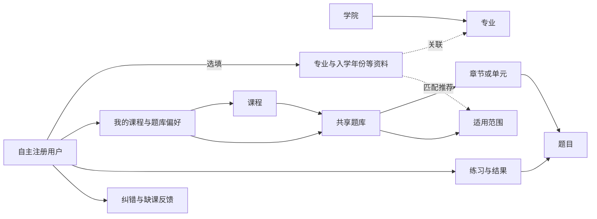
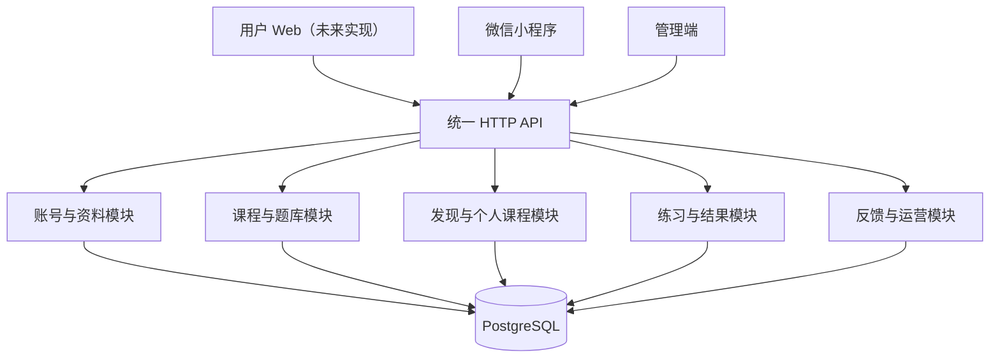

# QandA 学生自主复习平台架构报告

编写日期：2026-10-25

最近核对：2026-10-28

适用对象：产品、开发与内容运营团队

文档状态：产品定位与业务边界参考。后端实际关系模型、接口和验收结果见[后端架构与数据库](../backend-architecture.md)及[后端接口进度](../backend-progress.md)；管理端现状见[管理端学生平台改造说明](../admin-student-platform-implementation.md)。

## 1. 项目定位与设计目标

QandA 由学生团队开发和运营，首先服务本校大学生的期末复习与刷题需求。学生自主注册、自主选择课程和题库，团队负责整理资源、维护题目、处理反馈及运营平台。

平台的核心价值是：让学生快速找到适合自己的复习内容，并通过可靠的答案、解析和练习记录提高复习效率。

后台围绕三项工作建设：

1. **内容供给：** 高效导入、整理、发布和更新课程题库。
2. **内容发现：** 借助学院、专业、入学年份等信息推荐题库，同时支持学生自由搜索和选择。
3. **内容质量：** 通过校验、纠错和使用反馈持续改善题目。

学校、学院、专业、班级在本平台中主要用于内容分类和适用性说明。首期聚焦单校使用，不建设教务排课、学籍名册、行政班课程分配、官方成绩管理或强制修读流程。

### 1.1 设计原则

| 原则 | 具体含义 |
| --- | --- |
| 学生自主使用 | 学生注册后可以自行寻找、加入和移除课程，无须等待管理员分配 |
| 内容集中复用 | 同一份公共课内容维护一次，可供多个学院、专业和班级使用 |
| 推荐与访问分离 | 专业匹配影响推荐排序，不直接限制已发布内容的访问 |
| 注册过程简短 | 学院、专业等资料可以稍后完善，班级按实际需要选填 |
| 保留稳定身份 | 题目和题库使用稳定 ID，更新内容时保留学习记录的关联 |
| 小团队可维护 | 优先复用现有页面、Gateway、题型和数据结构，按实际需求扩展 |

## 2. 核心业务架构

### 2.1 三组关系

平台由“用户资料”“共享内容”“用户选择与学习记录”三组关系组成。



学院与专业构成分类目录；课程独立存在；题库通过适用范围关联目标学生。班级有实际差异时再作为补充条件，不作为内容访问的必经层级。

### 2.2 课程、题库、章节分别表达什么

| 概念 | 负责表达的内容 | 示例 |
| --- | --- | --- |
| 课程 | 稳定的学习主题，承载搜索与订阅 | 大学英语、高等数学 A、数据结构 |
| 题库 | 一份可以独立选择和维护的复习内容，说明教材、册次、范围等 | 高数 A 同济版上册基础题库 |
| 章节/单元 | 题库内部的学习顺序与分组 | 第一章：函数与极限 |
| 题目 | 题干、选项、答案、解析等最小练习单元 | 某道极限计算选择题 |
| 适用范围 | 题库推荐给哪些学生 | 计算机与机械专业、2025 级 |

同一课程可以拥有多个题库。题库须展示教材或大纲说明、覆盖范围、适用对象、更新时间等信息，帮助学生判断是否适合自己；这些说明由平台团队维护，不代表学校官方认证。

首期复用现有 `Subject` 表达“课程”，复用 `QuestionBank` 表达不同教材或复习范围的题库，无须先增加独立的教材版本管理系统。

### 2.3 公共课与专业课怎样复用

以“大学英语”为例：

- 建立一门课程，维护一份适用于全校的基础题库。
- 计算机、机械、中文等专业的学生访问同一个题库及同一批题目 ID。
- 若只是推荐对象不同，调整适用范围即可。
- 若某专业使用不同教材、不同册次，建立同课程下的独立题库，并明确说明区别。
- 若只是部分章节适合某班，初期通过题库说明与学生自选章节处理；出现持续需求后再增加可保存的复习范围。

“公共课”属于课程分类；“全校适用”属于推荐范围。二者均不自动将课程加入所有学生的“我的课程”。

第一阶段每道题仍归属一个题库，优先通过复用完整题库减少重复维护。后续确需把同一道题编入多个专题时，再增加题目与题集的引用关系，保持同一题目 ID。

## 3. 学生端使用流程

### 3.1 从注册到首次刷题

```text
自主注册或登录
→ 可选完善学院、专业、入学年份
→ 查看推荐课程，或直接搜索
→ 查看题库说明并选择题库
→ 选择章节、题量及练习方式
→ 刷题、查看结果和解析
→ 按需加入“我的课程”，下次继续复习
```

“加入我的课程”用于保存入口，不作为开始刷题的前置条件。用户没有填写专业，也可以搜索课程、浏览已发布题库并开始练习。

用户资料由学生自行填写，允许修改。入学年份保存为“2025”等稳定值；界面上的年级按学年计算，避免每年要求学生重新维护“大一、大二”。

班级选填，首期不强制建立全校班级名册。确有班级专属复习需求时，可增加轻量班级目录供选择，并由团队处理重复名称。

### 3.2 “推荐课程”与“我的课程”

| 区域 | 内容来源 | 用户操作 |
| --- | --- | --- |
| 推荐课程 | 已发布题库的适用范围与用户资料匹配 | 查看、加入、忽略推荐 |
| 我的课程 | 用户主动加入的课程 | 排序、选择常用题库、移除 |
| 全部课程 | 平台已发布且可用的课程与题库 | 搜索、筛选、跨专业浏览 |
| 继续练习 | 用户尚未完成的练习 | 恢复进度或主动结束 |

移除课程仅移除快捷入口，保留历史练习、错题和收藏。修改专业后重新计算推荐，保留用户已经加入的课程及学习记录。

首期可以为每门已加入的课程保存一个“常用题库”，同时允许学生进入同课程的其他题库。常用题库下架后提示重新选择，不擅自替换。

### 3.3 推荐规则保持可解释

首期采用明确规则即可：

1. 先筛选课程、题库均处于发布状态且有可练习题目的内容。
2. 优先展示符合专业和入学年份的题库，以及标记为全校适用的题库。
3. 同一课程拥有多个匹配题库时，先合并为一张课程卡片，再展示推荐题库及匹配原因。
4. 已加入的课程在“我的课程”中优先展示；推荐区域可去重。
5. 缺少资料时，提供全校适用课程和完整搜索入口，不猜测用户归属。

匹配原因可显示为“适用于计算机专业”“全校通用”。首期不依赖机器学习或复杂推荐服务。

## 4. 后台功能架构

### 4.1 建议菜单

| 一级模块 | 主要内容 | 优先解决的问题 |
| --- | --- | --- |
| 工作台 | 待处理纠错、待发布内容、缺课需求、近期使用概况 | 团队今天先做什么 |
| 课程与题库 | 课程、题库、章节、题目、导入、发布 | 内容怎样快速整理上线 |
| 分类与适用范围 | 学院、专业、入学年份条件、公共课分类 | 学生怎样找到适合自己的内容 |
| 反馈处理 | 题目纠错、课程需求、处理记录 | 答案是否可靠、还缺什么内容 |
| 用户与运营 | 注册用户、账号状态、公告、使用统计 | 平台是否有人使用、哪里需要改善 |
| 系统管理 | 管理员、权限、操作日志 | 谁可以修改什么、如何追踪 |

学院、专业目录集中维护；适用范围在题库编辑页配置，并支持批量修改。减少为了维护一份题库在多个页面来回切换。

### 4.2 题库工作台

每份题库的详情页建议集中提供：

- 基本信息：所属课程、教材说明、适用范围、内容负责人、状态。
- 内容组织：章节排序、题目数量、题型分布、未分章题目。
- 编辑操作：新建题目、批量导入、移动章节、预览学生端效果。
- 质量提示：缺答案、无效选项、缺解析、待处理纠错。
- 发布信息：最近更新时间、发布人、变更摘要。
- 使用概况：使用人数与近期练习量，随真实数据接入逐步完善。

核心工作流为：新建课程或选用已有课程 → 新建题库 → 建立章节 → 导入和检查 → 设置适用范围 → 预览 → 发布。

### 4.3 导入与发布

沿用现有 JSON 导入能力，后续确有需要再扩展表格模板。导入应支持章节信息、题型、答案和解析；展示文件名、题号或字段位置明确的错误提示。

首期采用整批校验、整批写入：存在无效题目时不写入，保留预览供修正。重复提交使用导入请求标识防止同一次操作写入两遍；相同题干只作重复提示，避免误删选项或答案不同的合法题目。

内容采用“草稿 → 已发布 → 已归档”状态；需要临时停止供学生使用时执行下架并记录原因。发布前必须通过题型、答案、选项和章节归属校验；缺解析作为明确提示，是否允许发布由团队的内容标准决定。

小团队阶段允许内容负责人检查后直接发布。多人独立审核、学生投稿审核在协作规模扩大后再增加。

### 4.4 学生纠错闭环

```text
学生在题目页提交纠错
→ 后台记录原题与反馈时的题目版本
→ 负责人核实
→ 修改题目或说明无需修改的原因
→ 标记处理结果
→ 学生查看结果
```

反馈类型可先限定为：答案有误、解析有误、题干或选项有误、其他。状态采用“待处理、处理中、已解决、无需修改”。同题反馈在后台聚合，保留各提交者的反馈记录。

缺课需求与纠错分开收集，记录课程名称、专业及简短说明。团队按重复需求和现有内容缺口安排整理优先级。

## 5. 领域模型与数据关系

以下为逻辑模型建议，字段用于说明职责，不代表已经冻结的数据库或 API 契约。

### 5.1 核心实体

| 实体 | 关键字段或关系 | 说明 |
| --- | --- | --- |
| `User` | `id`、账号状态、注册时间 | 自主注册的平台账号 |
| `UserProfile` | `userId`、`collegeId?`、`majorId?`、`enrollmentYear?` | 可选资料，班级在后续有需求时补充 |
| `College` / `Major` | 学院名称、专业所属学院 | 推荐与筛选使用的目录 |
| `Subject` | `id`、名称、别名、分类、发布状态 | 继续表达课程，别名帮助检索简称 |
| `QuestionBank` | `subjectId`、名称、教材说明、适用范围类型、发布状态 | 一份独立复习内容 |
| `Chapter` | `questionBankId`、名称、`sortOrder` | 初期只做一层章节 |
| `Question` | `questionBankId`、`chapterId?`、题干、选项、答案、解析、版本、状态 | 支持单选、多选、判断与简答 |
| `BankAudience` | `questionBankId`、`collegeId?`、`majorId?`、`enrollmentYear?` | 一份题库可有多条推荐条件 |
| `UserSubject` | `userId`、`subjectId`、`preferredBankId?`、排序 | 我的课程与常用题库 |
| `PracticeSession` / `PracticeResult` | 用户、题库、题目快照、提交与结果 | 服务端维护练习事实 |
| `QuestionFeedback` | 用户、题目 ID、题目版本、类型、说明、处理状态 | 纠错闭环 |
| `CourseRequest` | 用户、课程名、可选专业、说明、状态 | 尚未覆盖课程的需求 |

表中的 `?` 表示可空。院系资料不完整时，允许账号和学习功能正常使用。用户若填写专业，服务端校验其所属学院；可由专业推导学院，避免存入相互矛盾的资料。

题库的适用范围作为推荐事实来源。课程层面的适用专业由题库范围汇总，避免课程与题库各维护一套相互冲突的规则。

### 5.2 适用范围怎样匹配

`QuestionBank` 的范围类型为：

- `ALL`：全校适用，无须配置具体专业。
- `TARGETED`：至少配置一条有效范围，不能通过空条件伪装成全校适用。

`TARGETED` 采用“同一行条件同时满足，多行之间满足任一行即可”的规则。例如：

| 条件行 | 专业 | 入学年份 | 含义 |
| --- | --- | --- | --- |
| 1 | 计算机科学与技术 | 2025 | 适用于该专业 2025 级 |
| 2 | 机械工程 | 不限 | 适用于机械工程各年级 |

规则细节：

1. 未填写的条件表示该维度不限；一行至少填写一个有效条件。
2. 填写学院与专业时，专业必须属于该学院。
3. 用户缺少某项资料时，不能判定其符合要求该资料的条件。
4. `ALL` 与具体条件二选一，切换时清理旧条件并记录操作。
5. 不匹配只影响推荐，学生仍可通过搜索访问已发布题库。
6. 班级条件在后续建立轻量班级目录后再接入相同匹配逻辑。

### 5.3 关联与更新约束

- `Chapter` 属于一个题库；题目的 `chapterId` 必须与其 `questionBankId` 一致。
- 旧题目可以暂时没有章节，显示在“未分章”中，允许逐步整理。
- 同一用户与课程只保留一条 `UserSubject`，重复加入返回已有结果。
- 常用题库必须属于对应课程；学生修改专业不自动移除已加入课程。
- 已有内容、反馈或学习记录引用的课程、题库、题目优先归档或下架，避免直接物理删除。
- 章节含题时，删除前必须移走题目，或明确转入“未分章”。
- 修改题干、选项、答案或解析时递增题目版本；已创建练习使用服务端保存的题目与答案快照，保证作答与判题采用一致版本。
- 历史结果保留当时内容；必要时附“该题后来已修正”的提示，避免静默改变旧成绩。

首期只保留入学年份等必要字段以及题库范围说明。学期可以先以展示信息表达，暂不建立独立排课或教学计划模型；未来做跨校推广时，再评估学校实体和学校间课程映射。

## 6. 推荐、访问与管理权限

| 机制 | 解决的问题 | 首期规则 |
| --- | --- | --- |
| 推荐范围 | 默认向谁推荐 | 根据自填资料匹配题库适用范围 |
| 内容访问 | 用户能否打开、练习 | 已注册且账号正常的用户可访问已发布内容，与专业匹配无关 |
| 个人选择 | 首页保留哪些入口 | 用户自行加入、移除、排序课程 |
| 后台权限 | 谁能编辑与发布 | 服务端按管理员角色和负责内容校验 |

个人“忽略推荐”只改变展示偏好，不禁止访问课程。题库下架、账号停用和后台权限校验分别处理。

初期团队可先设平台管理员和内容管理员。前者维护系统、账号与分类目录；后者维护被授权的课程题库和反馈。小团队可由同一负责人兼任。

后续有学生投稿或更多协作者时，再区分录入、审核、发布权限。所有权限必须由服务端校验，前端隐藏按钮只承担界面表达职责。

## 7. 技术架构与接口边界

### 7.1 延续现有技术方向

| 层次 | 当前情况 | 建议 |
| --- | --- | --- |
| 管理端 | React、TypeScript、Vite、Arco Design、TanStack Query、Zustand | 复用组件、表单、查询缓存与 `AdminContentGateway` |
| 用户 Web | 当前没有实现；Web MVP PRD 保留未来产品范围 | 恢复实现时再沿用本文的课程、题库与练习边界 |
| 微信小程序 | 已有页面、ViewModel、Repository 与练习逻辑 | 经现有适配边界接入统一接口 |
| 后端 API | Kotlin、Spring Boot、Maven 与 MyBatis-Plus 的模块化单体 | 按当前合同接入客户端，验收入口见后端 README |
| 数据与契约 | PostgreSQL 使用完整建表脚本，OpenAPI 合同位于 `apps/api/contracts/openapi.yaml` | 保持初始化脚本、合同和运行验收一致 |

API 与数据库的当前实现和验证入口见[后端 README](../../apps/api/README.md)；管理端仍使用本地 Mock，小程序的题库与练习数据仍保存在本地。客户端业务联调、跨端数据共享及端到端生产流程仍待完成。



以上模块部署在同一个后端应用中，便于小团队开发和排查问题。初期采用数据库查询完成推荐和搜索；访问量、查询耗时与内容规模出现明确瓶颈后，再评估缓存、专用搜索或服务拆分。

### 7.2 建议接口职责

当前路径以[OpenAPI 合同](../../apps/api/contracts/openapi.yaml)为准，主要职责如下：

| 接口组 | 典型操作 |
| --- | --- |
| 账号与资料 | 注册、登录、读取及修改 `/api/v1/me/profile` |
| 内容发现 | 搜索 `/api/v1/subjects`，按课程查询题库，查看题库说明与章节 |
| 推荐 | 查询 `/api/v1/me/recommendations`，返回课程、推荐题库和匹配原因 |
| 我的课程 | 查询、加入、移除课程，保存常用题库和排序 |
| 练习 | 沿用 `/api/v1/practice/sessions` 的创建、恢复、提交和结果边界，增加章节筛选 |
| 反馈 | 提交题目纠错、缺课需求，查询自己的处理结果 |
| 管理内容 | 维护课程、题库、章节、题目、适用范围，导入、发布和下架 |
| 管理运营 | 处理反馈、查询统计、管理管理员与操作日志 |

章节筛选进入创建练习的请求后，由服务端校验章节归属、可用题数及发布状态。服务端固定本次题目集合、顺序与内容版本，负责判题；重复提交返回同一结果。

账号身份与院系资料分开保存。当前提供邮箱与微信注册登录；多端识别到同一用户后使用统一用户 ID，不以同专业、同姓名或自填学号自动合并账号。

### 7.3 性能与数据可靠性

- 课程、题库、题目和用户列表采用服务端分页，避免一次拉取全校数据。
- 对题库所属课程、题目所属题库与章节、用户课程关联、用户练习时间等常用查询建立索引。
- 为 `UserSubject(userId, subjectId)` 设置唯一约束；章节排序在题库内维护。
- 大批量导入使用事务并明确大小限制。规模超出同步处理能力后，再增加异步任务和进度查询。
- 题目数量等统计明确按已发布可用内容计算，不能将草稿计入学生端可练习数量。
- 上线前验证数据库备份与恢复、失败回滚、账号隔离和跨端记录一致性。

具体并发和响应时间目标应结合首批推广规模与压测结果确定，本文不将未经验证的全校承载量写成既成能力。

## 8. 客户端接入约定

后端关系模型、账号与内容规则以[后端架构与数据库](../backend-architecture.md)及当前 OpenAPI 为准。管理端目前使用本地 Mock，小程序的题库、练习与学习记录目前保存在本地；各端状态见对应应用说明。

客户端开始接入时按当前 `1.0.0` 合同实现 API 适配，并由后端维护共享业务数据。已有 Mock 或本地记录继续由客户端管理，只有明确安排导入时才写入后端。
